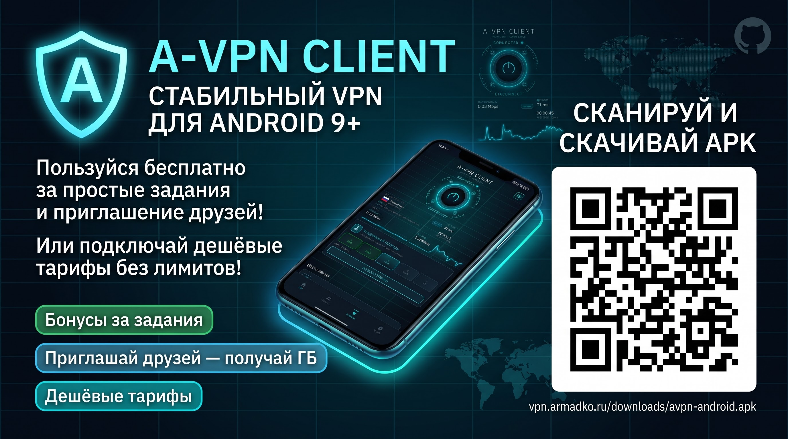

# 🛡️ A-VPN CLIENT for Android 

  

**A-VPN CLIENT** — это быстрый, стабильный и безопасный VPN-клиент, созданный специально для устройств на базе Android 9 и выше. 

Мы предлагаем уникальную и честную систему: вы можете пользоваться VPN **совершенно бесплатно**, просто сыграв в увлекательную мини-игру прямо в приложении, либо в любой момент подключить **очень дешевый безлимитный тариф** без каких-либо ограничений!

---

## 💡 Как это работает?

У нас гибкие условия, которые подойдут каждому:

1. **🎮 Бесплатный доступ через мини-игру:**
   Без ключа VPN открывается после прохождения мини-игры: проложите сетевой туннель от телефона к серверу. Каждая победа дает 1 час бесплатного защищенного подключения! С платным ключом игра не требуется.
2. **👥 Реферальная программа:**
   Приглашайте друзей по своему коду и получайте бонусы за каждого.
3. **💰 Дешёвые премиум-тарифы:**
   Не хотите проходить головоломку? Оформите подписку по самой доступной и низкой цене на рынке и забудьте о каких-либо лимитах!

---

## ✨ Возможности и особенности

*   **⚡ Высокая скорость и стабильность:** Подключайтесь к надежным серверам (Германия, Россия Fast) с минимальным пингом.
*   **🤝 Раздача Wi-Fi:** Делитесь защищенным VPN-соединением с другими устройствами через точку доступа прямо со смартфона.
*   **🛡️ Максимум безопасности:** Функции маскировки трафика (Камуфляж) и Shadow Tunnel защитят ваше соединение в любых сетях.
*   **📱 Современный интерфейс:** Стильный кибер-дизайн, встроенная мини-игра и подключение в один клик.

---

## 📥 Как скачать и установить?

### Вариант 1. Через раздел GitHub Releases (Рекомендуется)
Перейдите на страницу последнего релиза и скачайте установочный `.apk` файл из блока **Assets**:

  

### Вариант 2. Прямая ссылка (для Android 9+)
Нажмите на кнопку ниже, чтобы скачать APK-файл последней стабильной версии напрямую с нашего сервера:

  

### Вариант 3. Сканирование через QR-код
Просто наведите камеру смартфона на QR-код, чтобы мгновенно начать загрузку официального APK-файла:

  

*Официальная ссылка для скачивания:* `https://vpn.armadko.ru/downloads/avpn-android.apk`

---

## ⚙️ Требования
*   **ОС:** Android 9.0 (Pie) или новее.
*   **Разрешения:** Доступ к сети, создание VPN-соединения.

---

  Играйте в мини-игру, приглашайте друзей или выбирайте дешёвый тариф — оставайтесь на связи с <b>A-VPN CLIENT</b> на своих условиях!

